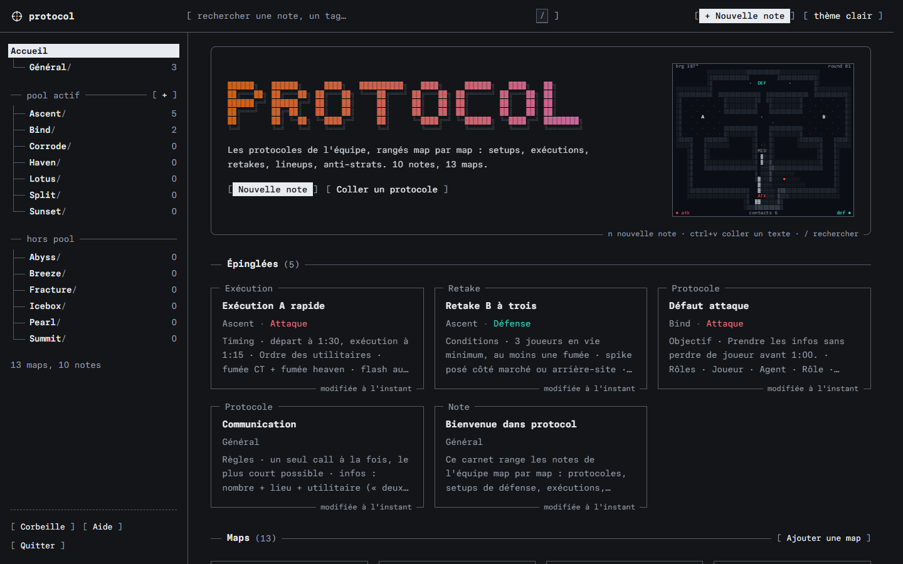
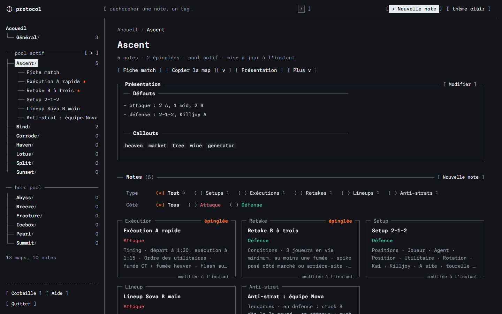
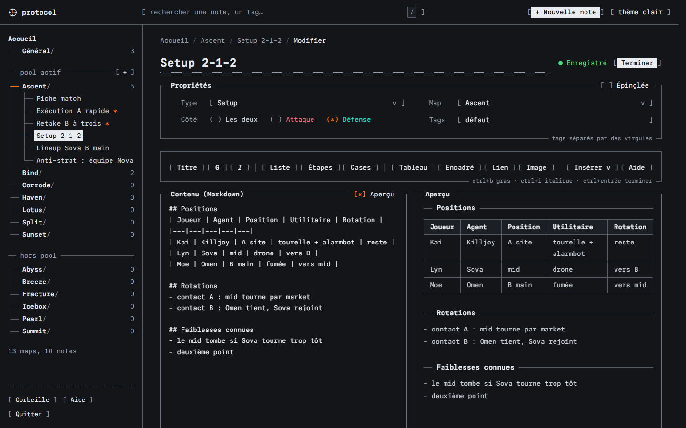
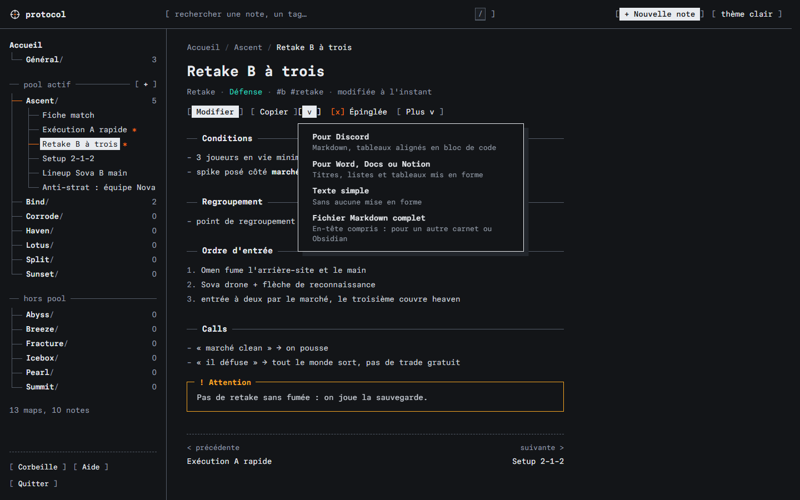
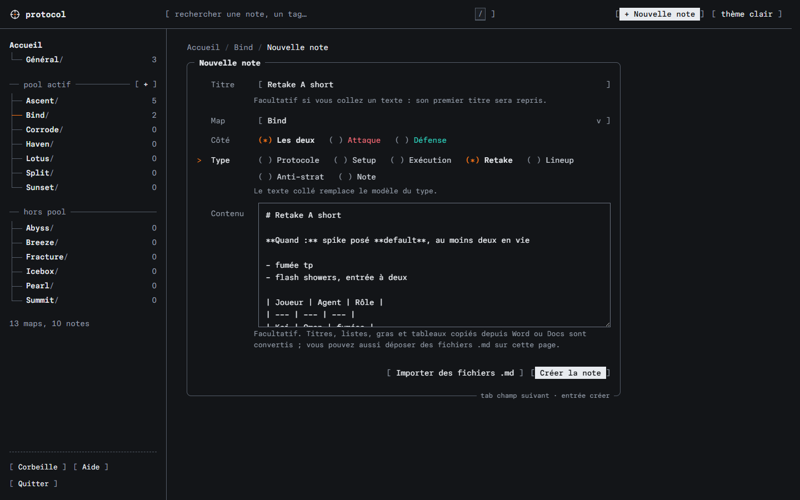

# protocol — a Valorant coach's notebook

**English** · [Français](README.fr.md)

Your team's protocols, filed map by map: defensive setups, executes, retakes, lineups, anti-strats, comms rules. Interface in English and French. A 2.0 MB executable, no installation, and **a single notebook file** next to it: nothing else, and nothing written anywhere else on the computer. Free software (MIT), no account, no network, no telemetry.



## Install

Download the latest version from the [releases page](https://github.com/IZn0gooD/valorant-protocol/releases/latest):

| System | File | Note |
|---|---|---|
| Windows 10/11 | `protocol-…-windows-x64.zip` | unzip, double-click `protocol.exe` |
| macOS (Intel and Apple Silicon) | `protocol-…-macos-universal.tar.gz` | beta; first launch: right-click → Open |
| Linux x64 | `protocol-…-linux-x64.tar.gz` | beta |
| Claude Desktop | `protocol-…-<system>.mcpb` | double-click: the AI assistant reads (and, if you allow it, writes) your notebook |

`SHA256SUMS.txt` lists the checksum of every file. Each archive also contains a one-page guide, `README.txt` in English and `LISEZMOI.txt` in French (the same ones as in the repository's `dist/` folder), and this README in both languages. The interface opens in Edge, Chrome, Brave or Chromium in app mode, otherwise in the default browser.

## Getting started

1. Copy `protocol.exe` wherever you like: USB drive, desktop, shared folder.
2. Double-click it. The notebook opens in its own window (Edge, Chrome or Brave in app mode).
3. Close the window when you are done: the program stops by itself.

On first launch, the file `protocol.carnet` is created next to the program, with a welcome note, the **General** map (team rules, not counted among the maps) and the 13 competitive maps, Summit included. To take the notebook with you or back it up, copy these two files together.

An old `notes/` folder (from earlier versions of protocol) placed next to the program is imported into the notebook automatically on first launch, without being modified; a message then tells you it can be deleted.

Launching the program again while it is running just reopens the window: there are never two programs on the same notebook.

### English or French

The interface exists in English and in French. By default it follows the system language: French if Windows (or macOS, Linux) is in French, English otherwise.

- **Switch language**: *Help › Langue / Language*, then *Auto*, *Français* or *English*. The choice is kept in the notebook: it follows the USB drive from one computer to the next.
- **Force a language**: the variable `PROTOCOL_LANG=en` or `PROTOCOL_LANG=fr` applies to the command line and the MCP server (the notebook's setting, if set, still wins).
- **A new notebook** is created in the chosen language: welcome note, "General" (or "Général") team map, note type templates. Notes you have already written are never translated.
- **The AI assistant** gets its tools, prompts and messages in the notebook's language.

### No trace on the computer

- The notebook, the only data file, stays next to the program. No folder in `%APPDATA%`, no registry key.
- The window uses a **temporary browser profile**, also stored next to the program (hidden folder `.protocol-session`) and erased on close: history, cache and page storage never go into the computer's Edge or Chrome profile. This browser runs inside a Windows "job": closing the window stops protocol, and stopping protocol closes the window.
- The chosen theme and language are kept in the notebook, not in the browser.
- If the program's folder is not writable (CD, protected share), the existing notebook opens read-only and the temporary profile goes into the Windows temp folder, also erased on close.
- With `--browser default`, your usual browser opens, with its own history: avoid it on a computer that isn't yours.

Windows itself keeps a record of launched programs (prefetch, recent items): that does not depend on protocol.

## The interface

The interface borrows the "ui" pieces of [ascii.rest](https://ascii.rest), with a single reading rule: **anything in brackets is clickable**.

| Piece | Where | What it is for |
|---|---|---|
| buttons `[ Copy ]` | everywhere | inverted on hover; the main button is inverted from the start (`[ Edit ]`, `[ Done ]`) |
| checkboxes `[x] Pinned` | note, editor | a toggle: pinned or not, preview shown or not |
| options `(*) Defense` | filters, forms | one choice among several: type, side |
| fields `[ Ascent  v ]` | forms | an input or a list; `>` marks the line you are on |
| titled frames | cards, overview, editor | a note's type in the top border, its date in the bottom one; useful shortcuts at the bottom of forms |
| dividers `── Notes (5) ──` | sections, note titles | open each part, with its count and its action |
| tree `├── Ascent/` | on the left | the maps (active pool first); the open map unfolds its **match sheet** and its notes, two clicks away during a timeout |

- **At the top**, search and `[ + New note ]`, always one click away.
- **Map names** are written in plain text, in the Paper Mono typeface from [paper.design](https://paper.design) used throughout the interface. Only the home page title keeps its block letters, next to the radar minimap.
- **Messages** show at the bottom, like a boot log: `[ OK ] Text copied.`, `[ !! ]` on failure.
- **Light and dark themes**, and in a small window (next to the game, for example) navigation moves into a drawer.
- **Accessible**: everything works from the keyboard (shortcuts speed things up, they replace nothing), focus always visible, real radio buttons and real toggles behind the brackets, animations off when the system asks, WCAG AA contrast measured on 112 elements in both themes (`tests/ui/ui-contrast.cjs`).

## Day to day

| To… | Do |
|---|---|
| write a protocol | **New note** (top right, or `N`): a title, a map, a type. The type's template is pre-filled (roles, timings, utility…). |
| reuse existing text | copy it in Discord, Word, Google Docs or Notion, then `Ctrl+V` on a notebook page: a new note opens, already filled in, title included. Or **Paste a protocol**, on the home page or in a map's menu. |
| find something | the search at the top of the screen (or `/`), then a few words. Accents and case ignored. Filters: `map:ascent`, `type:retake`, `side:def`, `#tag`, `"exact phrase"`. ↑ ↓ then Enter. |
| prepare a match | pin the key protocols, then **Match sheet** (or `F`): a condensed, printable page of the map, to keep in front of you during a timeout. |
| share with the team | **Copy** (or `C`) on a note, a map or the match sheet, then paste into Discord or a document. |
| illustrate a lineup | paste a screenshot (`Ctrl+V`) or drag an image into the editor. |
| switch maps | the sidebar, or `[` and `]`. Active pool maps are grouped at the top. |

The editor guides formatting: a toolbar (heading, bold, lists, checkboxes, table, callout, link, image), an **Insert** menu of ready-made blocks (roles table, timings, utility order, checklist, calls, callouts) and a cheat sheet. The preview updates as you type, saving is automatic. `Ctrl+S` forces a save, `Ctrl+Enter` or `Esc` closes the editor. A deleted note goes to the bin, and the message confirming it offers to undo.





## Copy, paste, import

**Copy** puts two versions on the clipboard, in a single click:

- **Markdown for Discord**: headings, bold and lists go through as they are; what Discord doesn't display is converted (a table becomes a code block with aligned columns, a checkbox ☐ or ☑, a callout a titled quote);
- **formatted text** for Word, Google Docs or Notion, images included.

The `[ v ]` button next to it picks a single format: For Discord, For Word, Docs or Notion, **Plain text** (no markup at all, for a text message or an email) or **Full Markdown file** (front matter included, for another notebook or Obsidian). A note's `[ More v ]` menu downloads it as `.md`; a map's downloads the whole map.



**Pasting** an existing protocol is enough to create a note: `Ctrl+V` anywhere on a notebook page, or in the *Content* field of a new note. Formatting from Word, Google Docs, Notion, Excel or a web page is converted to Markdown (headings, bold, italic, lists, including Word's numbered lists, tables, links), and the text's first heading becomes the note's title. In the editor, a rich paste is converted the same way; `Ctrl+Shift+V` pastes raw text.

**Import** `.md` files (Obsidian, another notebook, an export): drop them on a map, or go through its menu. The file's front matter is kept, unknown keys included, and an existing note is never overwritten.

**Export the whole notebook** as Markdown files: *Help › Your notebook › Export as Markdown files (.zip)*, or `protocol export --format zip -o notebook.zip`. The ZIP archive opens anywhere (Windows Explorer, macOS, Obsidian): one map = one folder, one note = one `.md` file, images in `assets/`.



## The notebook

Everything lives in `protocol.carnet`: maps and overviews, notes, pasted images, bin, settings. Each note stays Markdown with a small front matter, the format Obsidian, VS Code or GitHub read:

```markdown
---
title: 3-man B retake
type: retake
side: def
tags: [b, retake]
pin: true
updated: 2026-10-12T14:03:09Z
---

## Conditions
- 3 players alive, at least one smoke
```

Unknown front matter keys (added by Obsidian, for example) are kept. Links between notes: `[[retake-b]]`, or `[[bind/setup-a]]` to another map.

The file is a log: each save is appended at the end, with a checksum, and nothing is rewritten in place. A power cut or a USB drive pulled out mid-write loses at most the very last change, never the rest. Stale versions are regularly cleared out in the background: the file is rewritten alongside, then swapped in in one move, keeping the old one until the last moment. If part of the file becomes unreadable (damaged media), it is set aside at launch and a copy of the original file is kept.

If the same note is edited in two windows at once, the notebook doesn't overwrite it: it flags the conflict and lets you choose which version to keep.

## With other tools

Local **JSON API**, on `http://127.0.0.1:7373`:

| Request | Effect |
|---|---|
| `GET /api/state` | maps, pinned and recent notes |
| `GET /api/maps/ascent` | a map, its overview and its notes |
| `GET /api/notes/ascent/retake-b` | a note (Markdown and rendered HTML) |
| `PUT /api/notes/ascent/retake-b` | edit: JSON (`title`, `kind`, `side`, `tags`, `pin`, `body`, `baseVersion`) or the full Markdown text, front matter included (`Content-Type: text/markdown`) |
| `POST /api/notes/ascent` | create: `{"title": "…", "kind": "retake", "body": "…"}`, or import a full Markdown file (`Content-Type: text/markdown`, `?name=` for the file name) |
| `DELETE /api/notes/ascent/retake-b` | move to the bin |
| `GET /api/search?q=retake+b` | search |
| `GET /api/share/ascent/retake-b` | a note ready to share: `discord`, `text`, `markdown`, `html` |
| `GET /api/share/ascent?scope=pinned` | the match sheet (without `scope`: the whole map), same formats |
| `GET /api/export.json` | the whole notebook as a single JSON |
| `GET /api/export.zip` | the whole notebook as Markdown files (from the coach's computer) |
| `GET /api/export/ascent.md` | a map as a single Markdown file |
| `POST /api/settings` | settings kept in the notebook: `{"theme": "dark", "lang": "en"}` (`lang`: `fr`, `en` or `auto`) |

PowerShell example:

```powershell
Invoke-RestMethod "http://127.0.0.1:7373/api/search?q=retake" | Select-Object -ExpandProperty hits
```

A local web app (a dashboard, for example) can call the API from the browser if you allow it: `protocol --cors http://localhost:5173`.

**Command line**:

```text
protocol serve [--lan]            server only (no window, no automatic shutdown)
protocol search retake b          search from the terminal
protocol export -o notebook.json  the whole notebook as JSON
protocol export --format zip -o notebook.zip
                                  the whole notebook as Markdown files (Obsidian, readable backup)
protocol export --map ascent -o ascent.md
protocol export --map ascent --pinned --format discord
                                  the match sheet, ready to paste into Discord (--format text: no markup)
protocol mcp [--write]            MCP server for an AI assistant (see below)
```

Common options: `--carnet <file>` (or the `PROTOCOL_CARNET` variable), `--port <n>`, `--read-only`, `--browser app|default|none`. Messages follow the notebook's language; `PROTOCOL_LANG=en|fr` forces it. Command-line search and exports read the notebook without locking it: the window can stay open.

**Bootcamp, LAN**: `protocol serve --lan` shares the notebook read-only with players on the local network. An invitation link (`http://192.168.…:7373/?t=…`) is shown at launch: without it, another computer gets access to nothing, which matters on a tournament network shared with other teams. Only the coach's computer can edit, and the bin stays reserved for it.

## AI assistant (MCP)

`protocol mcp` turns the notebook into an [MCP](https://modelcontextprotocol.io) server (specification 2025-11-25, plus versions 2025-06-18, 2025-03-26 and 2024-11-05) for Claude Desktop, Claude Code or any other client: the assistant installed on the computer launches the program and talks to it over standard input and output. protocol contacts no AI itself, opens no port and asks for no key. The server speaks the notebook's language (tool descriptions, ready-made prompts, error messages); `PROTOCOL_LANG=en|fr` in the client's configuration sets it for a notebook left on automatic.

The exact configuration for the computer (real paths, read-only or with write access) is in **Help › AI assistant (MCP)**, ready to copy. By hand, with the USB drive on `E:`:

```json
{ "mcpServers": { "protocol": { "command": "E:/protocol.exe", "args": ["mcp", "--carnet", "E:/protocol.carnet"] } } }
```

```text
claude mcp add --scope user protocol -- E:/protocol.exe mcp --carnet E:/protocol.carnet
```

`--write` at the end of the arguments allows writing.

| What the assistant finds | |
|---|---|
| **Read tools** | `list_maps`, `get_map`, `list_notes` (by map, type, side, tag, pinned; paginated), `read_note`, `search_notes` (the search filters), `match_sheet`, `list_tags`, `recent_notes`, `format_note` (Discord, text, Markdown), `list_trash` |
| **Write tools** (`--write`) | `create_note`, `update_note`, `append_to_note`, `set_pinned`, `move_note`, `trash_note`, `restore_from_trash`, `create_map`, `update_map` |
| **Resources** | `protocol://note/{map}/{id}`, `protocol://map/{map}`, `protocol://sheet/{map}` (match sheet), `protocol://search/{query}`, `protocol://guide`, `protocol://types`; paginated list and subscriptions (a followed note that changes, in the window or elsewhere, is reported) |
| **Ready-made prompts** | Summarize a protocol, Find the weaknesses, Suggest a variation, Prepare a match, Debrief a match, File a text into the notebook: each attaches the relevant notes to the message |
| **And also** | argument completion (maps, notes), logging (`logging/setLevel`), structured outputs that match their schema, annotations (read-only, destructive, idempotent) |

What protects the notebook, by design:

- **No port**: the stdio transport restricts access to the client that launched the server, as the specification recommends for a local server.
- **Read-only by default**: without `--write`, the write tools don't exist, and a call is refused.
- **Nothing irreversible**: `trash_note` moves to the bin. `update_note` and `update_map` require the version that was read (nothing is overwritten if the note changed in the meantime) and leave the previous version in the bin, where "Restore" puts it back alongside. No tool deletes permanently or acts in bulk, and the bin can only be emptied in the window.
- **Rate-limited writes** (30 per minute) and **bounded inputs** (8 MB per message, 1 MB per note, 500 characters per search).
- **Note text is data**: the instructions given to the assistant say so, so that a booby-trapped pasted text isn't taken as an order.
- **No lock held**: an assistant can run for hours without blocking the window. The notebook is followed read-only; a write goes through the window if it is open (its local API, on 127.0.0.1, after checking it really serves this notebook), otherwise the notebook is opened for the duration of the operation, then released.

Checked with both official clients: `tests/mcp/conformance.py` (Python SDK) and `tests/mcp/conformance-ts.mjs` (TypeScript SDK, the one behind Claude Desktop and Claude Code) validate every message and every tool output against the protocol's schemas.

## Security

The notebook is a local server; it is built so that no website open in the browser can read or modify the notes:

- the `Host` header is checked (no "DNS rebinding");
- a change is only accepted from this computer, from the interface itself (or an origin allowed by `--cors`), and with a content type that a third-party form cannot send;
- in `--lan` mode, other computers must present the invitation link's token (then kept in an `HttpOnly` cookie), and can only read;
- Markdown is rendered without active HTML: a `<script>` tag shows up as text, `javascript:` links are neutralized;
- the page enforces a strict content security policy (no external or inline script);
- the server reads no file on the computer: notes and images come from the notebook, and only images are served;
- requests are bounded in size and duration, and the number of connections is limited;
- a single program writes to a notebook (locked file), every write is verified by a checksum and appended at the end of the file: a power cut never leaves a half-written note.

## Performance

Measured on a notebook of 520 notes (2.1 MB of Markdown), Windows 11, production binary:

| Measure | Result |
|---|---|
| program size | 2.0 MB, interface, fonts, both languages and MCP server included |
| notebook size | 2.2 MB |
| launch, notebook read and search (`protocol search`) | 65 ms |
| full-text search | 1 to 5 ms |
| displaying a note, a map | 1 ms |
| full export: JSON (2.3 MB) / Markdown files (ZIP) | 9 ms / 17 ms |
| memory | 17 MB |

## Why Rust

The brief: lightweight, portable, compatible with other tools, optimized. Among the available language experts (Ballerina, COBOL, C/C++, Crystal, C#, Elixir, Gleam, Hare, Java, JavaScript, Julia, Koka, Mojo, MoonBit, Nim, Odin, Python, Rust, Zig), **Rust** is the only one that ticks every box at once:

| Language | Single executable, no runtime | Size | Memory safety | Tools on this computer | Ecosystem for this need |
|---|---|---|---|---|---|
| **Rust** | yes | ~1 MB | yes | yes (1.94, MSVC) | mature (Markdown rendering, tests) |
| Zig | yes | < 1 MB | partial | portable, not on PATH | young, unstable standard library (0.16) |
| C/C++ | yes | < 1 MB | no | no compiler on PATH | everything by hand |
| Nim, Odin, Crystal | yes | ~1 MB | varies | not installed; Crystal still fragile on Windows | limited |
| C# (.NET 10 AOT) | yes | 10 to 30 MB | yes | yes | mature, but heavy for this need |
| JavaScript (Node) | no (or 80 MB bundled) | — | yes | yes | mature |
| Python | no (or 15 MB bundled) | — | yes | yes | mature, slow startup |
| Java, Elixir, Gleam, Julia, Ballerina | no (JVM, BEAM…) | heavy | yes | — | off topic |
| Hare, Koka, MoonBit, Mojo, COBOL | — | — | — | no native Windows, or research language | off topic |

The interface itself is HTML, CSS and JavaScript with no framework: the browser is already there, no need to ship Electron (over 100 MB).

The code was then reviewed by two expert agents, each in its own language, every finding reproduced before being reported:

- **Rust**, with ANSSI's secure programming guide: the security model holds (47 XSS payloads with no effect, path traversal, CSRF and rebinding blocked). A dozen real defects were fixed: ETag reused from one launch to the next, possible panic in the bin, a leaking connection counter, possible overwrites under a Windows lock, LAN sharing without authentication…
- **JavaScript**: no injection, CSP respected. The editor's lifecycle was reworked: a closed editor never writes again, a pasted image can no longer land in another note, a slow view no longer covers the next one, drafts no longer raise false alarms.

The interface redesign and copy-paste had their own review, under the same conditions:

- **JavaScript**: no escaping flaw, CSP respected. About twenty real defects fixed: Esc in the cheat sheet closing the editor, Enter on "Import" submitting the form, the theme switch emptying a new note (it is now kept as a draft), focus moved by a refresh, Word properties misread on paste, images downloaded on every display (they now are only when copying).
- **Rust**: no panic or flaw on import (760,000 randomly generated documents). Fixed: an unclosed code block swallowing the next note in a map export, quadratic processing time on a booby-trapped line that could freeze the notebook (now linear, and formatting happens outside the lock), a `---` line swallowed after a table.

Every fix is covered by a test: unit, end-to-end, or a scenario in a driven browser.

## Building from source

```powershell
cargo build --release      # target\release\protocol.exe
cargo test                 # 108 tests: unit, end-to-end (real HTTP server) and command line
```

The code is portable: `cargo build --release` on Linux or macOS produces the equivalent. A single dependency, `pulldown-cmark` for Markdown. The HTTP server, JSON, the notebook format and the ZIP archive are hand-written to stay light and readable.

| File | Role |
|---|---|
| `src/main.rs` | command line, launch, import of an old `notes/` folder |
| `src/platform.rs` | the window (browser with a temporary profile, inside a Windows job), the file explorer |
| `src/api.rs` | API routes and security rules |
| `src/store.rs` | the notebook: maps, notes, images, bin, settings, background compaction |
| `src/carnet.rs` | the notebook file: log, checksums, recovery after a power cut, lock |
| `src/zip.rs` | export as Markdown files (ZIP archive) |
| `src/note.rs` | notes' YAML front matter and per-type templates |
| `src/i18n.rs` | the chosen language (notebook setting, `PROTOCOL_LANG`, system language) |
| `src/render.rs` | Markdown to sanitized HTML |
| `src/share.rs` | a note formatted for Discord or as plain text |
| `src/search.rs` | search and excerpts |
| `src/http.rs`, `src/json.rs` | minimal HTTP server and JSON |
| `src/mcp.rs`, `src/mcp/` | MCP server: transport and lifecycle, tools, resources, ready-made prompts, lock-free writes (`link.rs`) |
| `web/` | the interface, embedded in the executable at compile time (`app.js` the views, `clip.js` the clipboard, `i18n.js` the English dictionary) |
| `tests/ui/` | 6 browser scenarios (Puppeteer): flows, copy-paste, contrast, English interface (`ui-i18n.cjs`); plus the static translation check (`i18n-check.cjs`). How to run them (in French): [`tests/ui/LISEZMOI.md`](tests/ui/LISEZMOI.md) |
| `tests/mcp/` | MCP server conformance, checked by the official Python and TypeScript SDKs |

## Credits

Art direction after [ascii.rest](https://ascii.rest) (bas3line, MIT license): its "ui" pieces (frames, form controls, dividers, tree, boot log) inspire the interface, its `banner` and `mount` modules draw the home page title; the animated minimap follows the format of its pieces. [Paper Mono](https://github.com/paper-design/paper-mono) typeface (OFL), lines and blocks taken from JetBrains Mono (OFL), Markdown rendering by [pulldown-cmark](https://github.com/pulldown-cmark/pulldown-cmark) (MIT). Full texts in [`web/LICENSES.txt`](web/LICENSES.txt), also served by the application at `/static/licenses.txt`.

## License and legal notice

protocol is distributed under the [MIT license](LICENSE).

protocol isn't endorsed by Riot Games and doesn't reflect the views or opinions of Riot Games or anyone officially involved in producing or managing Riot Games properties. Riot Games, and all associated properties are trademarks or registered trademarks of Riot Games, Inc.
